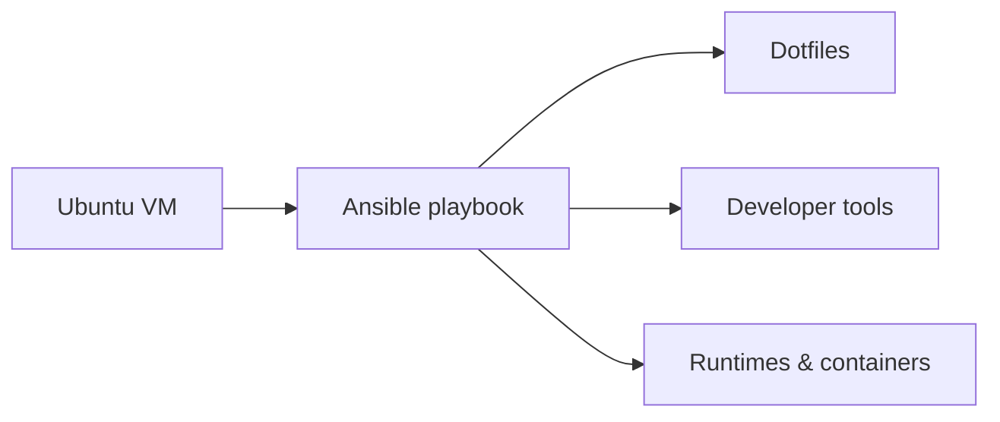

<h1 align="center">Workstation</h1>

<p align="center">
  Reproducible Ubuntu development environment managed with Ansible.<br>
  Configures Ubuntu 24.04 / 26.04 LTS on a VM, physical machine or WSL 2 across three areas: dotfiles, developer tools, and runtimes &amp; containers.
</p>

<p align="center">
  <a href="https://github.com/alikayar/workstation/actions/workflows/ci.yml">
    
  </a>
</p>

## Design goals

- **Reproducible:** workstation configuration lives in version control.
- **Idempotent:** CI applies the playbook twice and requires `changed=0` on the second run.
- **Portable:** the same Ubuntu roles work on VMs, physical machines and WSL 2; platform prerequisites are checked before installation.
- **Modular:** Ansible roles can be applied independently with tags.

## Architecture



## What it manages

- **Dotfiles:** Zsh, Git, Starship, and Codex CLI configuration.
- **Developer tools:** GitHub CLI, Delta, bat, fd, ripgrep, jq, and yq.
- **Runtimes & containers:** language runtimes via mise; Docker Engine, Compose, and Buildx.

## Quick start

On Ubuntu 24.04 or 26.04 LTS with internet access and `sudo`, run from the repository root. For WSL 2, first review the systemd and Docker choices in the [setup guide](docs/getting-started.md#wsl-2).

```bash
sudo apt-get update
sudo apt-get install --yes ansible-core python3-debian sudo
cp ansible/host_vars/localhost.example.yml ansible/host_vars/localhost.yml
```

Edit `ansible/host_vars/localhost.yml` and set your Git identity.

Optional: preview changes before applying them:

```bash
ansible-playbook ansible/site.yml --check --diff --ask-become-pass
```

Apply the configuration:

```bash
ansible-playbook ansible/site.yml --ask-become-pass
```

Privilege escalation automatically prefers `/usr/bin/sudo.ws` when available and no become executable override was supplied. Older Ubuntu installations continue using their configured `sudo`. The same preflight runs for tagged and check-mode invocations. See the [sudo compatibility notes](docs/getting-started.md#sudo-compatibility) for details.

CI applies the workstation twice on Ubuntu 24.04 and 26.04 and requires an unchanged second run. Separate disposable-container tests exercise password-based sudo, explicit overrides and the absence of the optional classic binary.

## Documentation

See the [setup guide](docs/getting-started.md), [tool inventory](docs/tools.md), and design notes for [shell](docs/shell.md), [mise](docs/mise.md), and [Codex](docs/codex.md). This personal workstation configuration is shared as a reference under the [MIT License](LICENSE).
