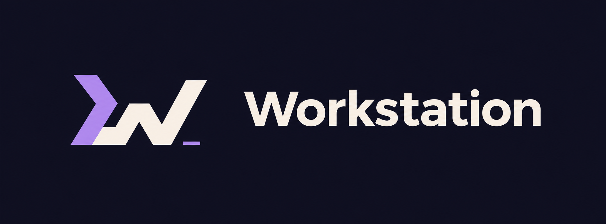

<h1 align="center"></h1>

<p align="center"><strong>An isolated, rebuildable Ubuntu VM for development.</strong></p>

<p align="center">
  <a href="https://github.com/alikayar/workstation/actions/workflows/ci.yml"></a>
  <a href="LICENSE"></a>
  <a href="docs/getting-started.md"></a>
  <a href="docs/windows.md"></a>
  <a href="docs/getting-started.md"></a>
</p>

Run project code, dependencies and coding agents inside a dedicated Ubuntu VM. Connect from your host over SSH and use Ansible to recreate the setup when you need a clean environment. Maintainer instructions and tool usage are documented in this repository.

| Environment | Role |
| --- | --- |
| **Host** | Connect from Codex or VS Code, review changes and preview applications through a tunnel. |
| **Ubuntu VM** | Keep project repositories and run commands, builds, containers and browser checks. |

## What Workstation provides

- **Ubuntu development setup.** Ansible configures the shell, Git, language runtimes, Docker, Codex and MCP integrations. Browser sessions are scoped to each task and cleaned up afterward.
- **Optional Windows tooling.** `wvm` creates and manages Hyper-V guests from reusable Packer images. It also configures host apps and provides read-only diagnostics through `wvm doctor`.
- **Development and agent tooling.** Shared tools support code discovery, browser automation, diagnostics and page/site audits across projects. See the [tooling summary](#included-tooling) below and the [full inventory](docs/tools.md) for details.

## Included tooling

The default Ubuntu setup provides these tools; project manifests and lockfiles still own application dependencies.

| Area | Tools | Purpose |
| --- | --- | --- |
| Shell | Zsh, Starship, fzf, zoxide, tmux | Navigation, completion and persistent terminal sessions. |
| Runtimes | mise; Node.js, Python, Go, Bun, PHP; uv, Composer | Managed runtimes and dependency tooling. |
| Git and CLI | Git, GitHub CLI, Delta, jq, yq, btop | Repository work, structured data and VM monitoring. |
| Containers | Docker Engine, Compose, Buildx | Run application stacks and build images. |
| Coding agent | Codex CLI | Managed agent configuration, instructions and command rules. |
| Code discovery | Graphify, ripgrep, fd, ast-grep | Local repository indexing, text and structural search. |
| Browser automation | agent-browser, managed Chrome | Task-scoped browser automation; native Chrome on x86_64. |
| Website audits | Lighthouse, SiteOne Crawler | Page measurements and bounded site-wide crawling. |
| Agent integrations | Serena, Context7 | Code navigation and current library documentation. |

MarkItDown conversion and the Chrome DevTools, Grafana and PostgreSQL MCP integrations are opt-in. See the [full tool inventory](docs/tools.md) for installation details and the [agent environment guide](docs/agent-environment.md) for usage. Installed tools do not start audits or grant permission to run checks.

## Quick start

**Use a dedicated Ubuntu VM for the full setup.** The playbook uses `sudo`, configures Codex with full filesystem access inside Ubuntu, and adds the development user to the Docker group by default. That group grants root-equivalent access inside Ubuntu. Review the [Codex permissions](docs/codex.md) and [Ubuntu setup options](docs/getting-started.md) before applying the playbook.

### Use an existing Ubuntu VM

Prepare a non-root user with sudo access, a reachable SSH server, and a [host SSH alias](docs/host.md#add-a-host-side-ssh-alias). Inside the VM, as the development user:

```bash
sudo apt-get update
sudo apt-get install --yes git ansible-core python3-debian sudo
git clone https://github.com/alikayar/workstation.git
cd workstation
cp -n ansible/host_vars/localhost.example.yml ansible/host_vars/localhost.yml
nano ansible/host_vars/localhost.yml
ansible-playbook ansible/site.yml --ask-become-pass
```

Enter your Git author name and email in the local variables file before applying the playbook. From the host, run `ssh workstation 'hostname; id -un'` with your SSH alias to verify the guest hostname and user. Then [open a remote project](docs/host.md) in Codex or VS Code.

### Create an Ubuntu VM on Windows 11 Pro

In a normal 64-bit PowerShell window with Git available:

```powershell
git clone https://github.com/alikayar/workstation.git
Set-Location workstation
.\host\windows\wvm\Install-WVM.ps1
```

Open an administrator PowerShell window as the same Windows user:

```powershell
wvm create -OS ubuntu-26-04
ssh workstation-ubuntu-26-04 'hostname; id -un'
```

If prompted to enable Hyper-V, restart Windows and rerun the create command. The development-environment prompt defaults to Yes and applies Ansible inside the VM. Choose No for an Ubuntu-only install. If you set a custom VM name, use it as the SSH alias. The [Windows guide](docs/windows.md) covers prerequisites, Windows guest creation, VM lifecycle, and optional host setup.

## Compatibility and verification

| Area | Coverage |
| --- | --- |
| **Ubuntu provisioning** | Relevant PRs/pushes run source checks. A manual [CI run](.github/workflows/ci.yml) provisions Ubuntu 24.04/26.04, checks second-apply idempotency and isolated regressions; browser smoke is opt-in. See [coverage and evidence](docs/verification.md). |
| **Windows scripts** | The manual CI run parses scripts with Windows PowerShell 5.1 and PowerShell 7. The [Windows validation notes](docs/windows.md#recovery-compatibility-and-validation) describe live Hyper-V checks and remaining coverage. |
| **Other Ubuntu environments** | The [Ubuntu guide](docs/getting-started.md) covers WSL 2 and architecture differences. The full CI install runs on x86_64. |

## Isolation boundaries

Use a fresh VM for unfamiliar code. Keep work credentials, shared host folders and access to internal services out of it. On Hyper-V, the Ubuntu workflow applies a host-enforced IP policy on a shared switch. See the [network policy and validation notes](docs/windows.md#network-isolation) for its scope and limits. When using an existing VM, configure isolation through your hypervisor or provider.

## Documentation

Start with the guide for your next task. Each topic has one maintained home.

| Task | Guide |
| --- | --- |
| Connect a host, open a remote project or preview an app | [Host connections](docs/host.md) |
| Install Ubuntu defaults, update or recover an apply | [Ubuntu setup](docs/getting-started.md) |
| Create/manage Hyper-V VMs or configure Windows apps | [Windows and wvm](docs/windows.md) |
| Find an installed tool and its provisioning owner | [Tool inventory](docs/tools.md) |
| Use browsers, repository indexing, conversion or audit CLIs | [Agent environment](docs/agent-environment.md) |
| Manage Codex settings, instructions and diagram plugin | [Codex configuration](docs/codex.md) |
| Activate an optional server or resolve MCP prerequisites | [MCP integrations](docs/mcp.md) |
| Understand shell activation and project runtime selection | [Shell](docs/shell.md), [mise/PHP/Composer](docs/mise.md) |
| Configure host and remote editor defaults | [VS Code](docs/vscode.md) |
| Choose checks and understand CI evidence | [Verification](docs/verification.md) |

## License

[MIT](LICENSE).
